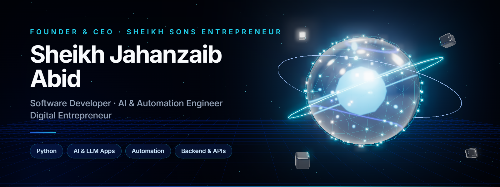
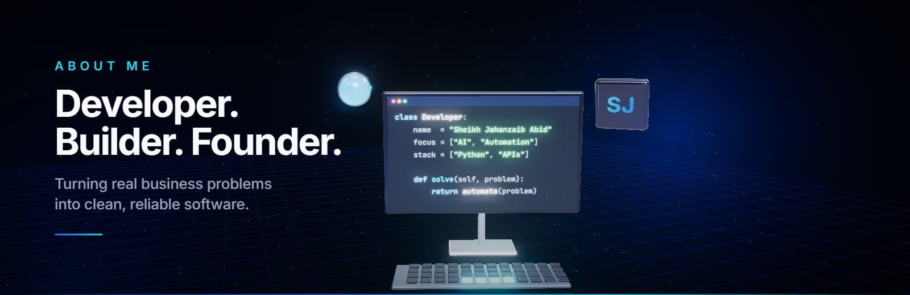
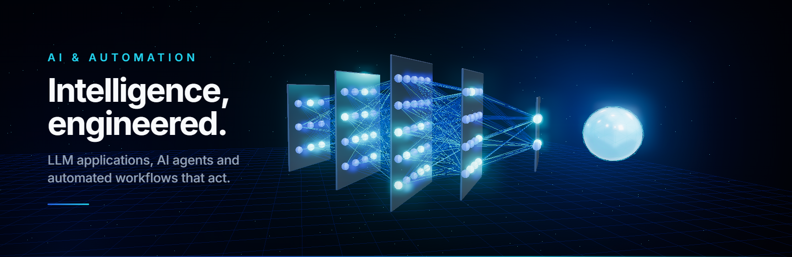
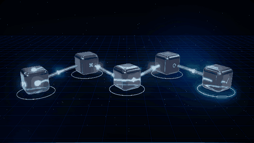
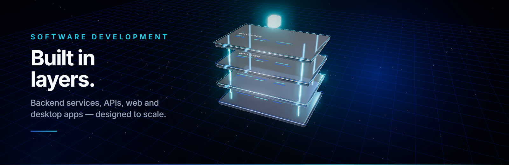
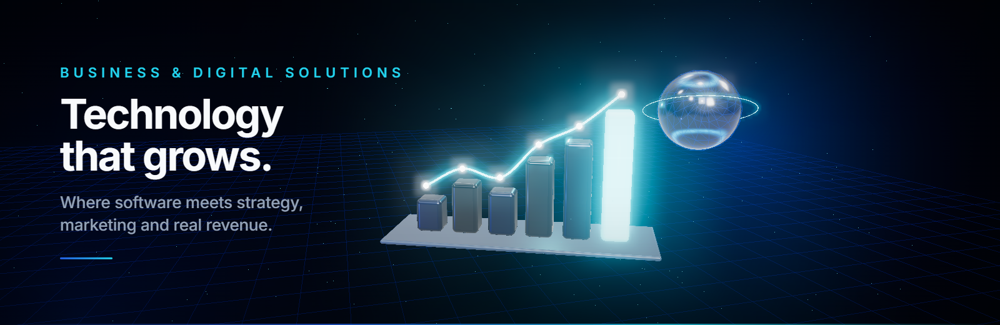
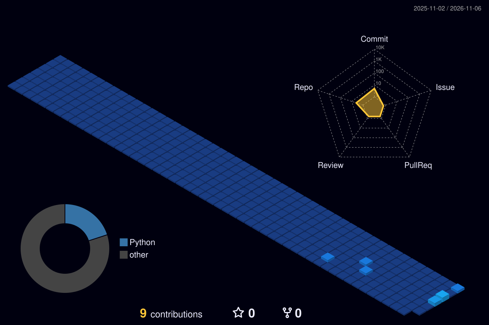
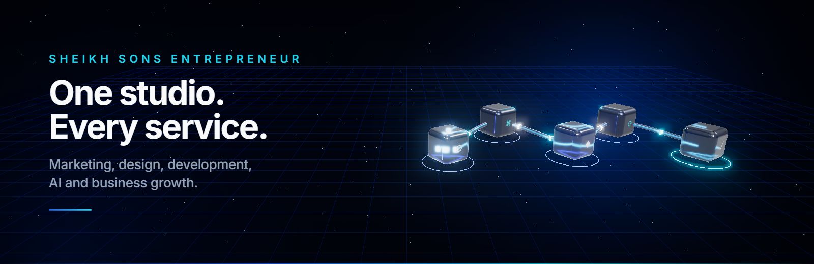

<!-- ═══════════════════════════ 1 · HERO ═══════════════════════════ -->

  

<!-- ═══════════════════════════ 2 · HEADLINE ═══════════════════════════ -->
<h1 align="center">Sheikh Jahanzaib Abid</h1>

  <b>Software Developer · AI &amp; Automation Engineer · Founder &amp; CEO of Sheikh Sons Entrepreneur</b>

  

  
  
  

 

<!-- ═══════════════════════════ 3 · ABOUT ═══════════════════════════ -->

## About Me

I'm **Sheikh Jahanzaib Abid**, a software developer and automation engineer from Pakistan, and the founder and CEO of **Sheikh Sons Entrepreneur**.

I build software that takes repetitive, time-consuming work off people's plates. Most of my time goes into **Python**, **AI and LLM-powered applications**, and **automation systems**: the backend logic, APIs and tooling that let a business run faster with fewer manual steps.

Running a company has shaped how I write code. I start from the business problem, not the technology. I prefer simple, dependable solutions to clever ones, and I measure success by whether the software keeps working long after launch day.

> *"If a task is done twice, it deserves to be automated."*

 

<!-- ═══════════════════════════ 4 · JOURNEY ═══════════════════════════ -->
## My Professional Journey

| Stage | Focus |
|:--|:--|
| 🧭 **Foundations** | Started with Python and fell in love with making computers do the boring work |
| 🏢 **Entrepreneurship** | Founded **Sheikh Sons Entrepreneur** and grew it into a multi-department digital agency that I lead as CEO |
| ⚙️ **Engineering** | Shifted my own work toward automation engineering, backend development and API integrations |
| 🧠 **Today** | Building AI and LLM applications and AI-powered business workflows |

Most of my engineering work is private or client-confidential, so only a small part of it appears on this profile.

 

<!-- ═══════════════════════════ 5 · WHAT I DO ═══════════════════════════ -->
## What I Do

<table>
  <tr>
    <td width="50%" valign="top"><h3>🧠 AI &amp; LLM</h3>LLM-powered apps, AI agents and API integrations that reason, respond and act.</td>
    <td width="50%" valign="top"><h3>⚙️ Automation</h3>Workflow and browser automation that replaces manual, repetitive processes.</td>
  </tr>
  <tr>
    <td width="50%" valign="top"><h3>🧩 Backend</h3>Python services, REST APIs and integrations that connect systems together.</td>
    <td width="50%" valign="top"><h3>🖥️ Applications</h3>Web and desktop applications built around real business workflows.</td>
  </tr>
</table>

 

<!-- ═══════════════════════════ 6 · EXPERTISE ═══════════════════════════ -->
## Technical Expertise

| Area | Skills |
|:--|:--|
| **Languages** | Python · JavaScript · HTML · CSS · SQL |
| **AI & LLM** | LLM application design · prompt engineering · AI agents · OpenAI &amp; Claude API integration |
| **Automation** | Workflow automation · browser automation (Playwright, Selenium, Chrome DevTools Protocol) · scheduling |
| **Backend & APIs** | REST APIs · FastAPI / Flask · third-party API integration · data processing |
| **Applications** | Web applications · desktop tools · admin dashboards |
| **Engineering Practice** | Git &amp; GitHub · GitHub Actions · documentation-first planning · AI-assisted development |

 

<!-- ═══════════════════════════ 7 · AI & AUTOMATION ═══════════════════════════ -->

## AI &amp; Automation

I design AI features as **dependable product components**, not demos: clear inputs, predictable outputs, guardrails and a fallback when the model is unsure.

- **LLM applications:** assistants, content and data pipelines, and decision helpers built on modern language models
- **AI agents:** multi-step workflows that use tools, call APIs and finish tasks from start to end
- **Workflow automation:** turning manual business processes into scheduled, monitored jobs
- **AI API integration:** adding OpenAI, Claude and other AI services to existing systems

  
  

 

<!-- ═══════════════════════════ 8 · SOFTWARE ═══════════════════════════ -->

## Software Development

I build software in clean layers, **interface → API → services → data**, so each part can be tested, replaced and scaled on its own.

- **Backend development:** Python services, background workers and REST APIs
- **Web applications:** dashboards and internal tools for day-to-day operations
- **Desktop applications:** focused utilities that save teams hours of manual effort
- **Integrations:** connecting CRMs, payment systems, messaging platforms and third-party APIs

 

<!-- ═══════════════════════════ 9 · BUSINESS ═══════════════════════════ -->

## Business &amp; Digital Solutions

Because I run a digital agency, I understand what software has to do **commercially**: win customers, cut costs and scale operations. That's where my engineering and business sides meet:

- Translating business goals into technical requirements and roadmaps
- AI-powered workflows for marketing, sales and customer support
- Automating operations so teams can focus on growth
- Choosing practical, cost-effective technology for small and growing businesses

 

<!-- ═══════════════════════════ 10 · TOOLS ═══════════════════════════ -->
## Technologies &amp; Tools

   
  

  
  
  
  
  
  
  

 

<!-- ═══════════════════════════ 11 · STATS ═══════════════════════════ -->
## GitHub Statistics

  

  

<!-- ═══════════════════════════ 12 · ACTIVITY ═══════════════════════════ -->
## Contribution Activity

  

All statistics are generated from real GitHub data by GitHub Actions in this repository. Private contributions are counted only when "Include private contributions" is turned on in profile settings. No repository names are shown.

 

<!-- ═══════════════════════════ 13 · PHILOSOPHY ═══════════════════════════ -->
## Development Philosophy

| | Principle | In practice |
|:--:|:--|:--|
| 🎯 | **Problem first** | Understand the business outcome before choosing the technology |
| 🧱 | **Simple beats clever** | Readable, maintainable code that the next developer can trust |
| 🛡️ | **Built to last** | Error handling, logging and monitoring are features, not extras |
| 🔒 | **Privacy by default** | Client data, credentials and business logic stay confidential |

 

<!-- ═══════════════════════════ 14 · COMPANY ═══════════════════════════ -->

## Sheikh Sons Entrepreneur

**Sheikh Sons Entrepreneur** is the full-service digital, AI and automation agency I founded and lead as CEO. It is based in Gujranwala, Pakistan, and serves clients in Pakistan, the United States, the UAE and South Korea.

> The sections above describe **my personal technical work**. The list below is the **full service catalogue of the company**, delivered by its team across specialist departments.

  
  
  
  

Figures as published on the company website.

<b>📣 Digital Marketing &amp; Advertising</b>

 

- **Marketing & Advertising:** brand marketing & strategy, sales growth marketing, social media marketing (SMM), Facebook Ads, Instagram advertising, Google Ads (Search & Display), YouTube advertising, TikTok ads & marketing, search engine marketing (SEM), content marketing
- **SEO & SEM:** on-page, off-page & technical SEO, keyword research, SEO audits, local SEO, Google Business Profile optimisation, Google Ads management, competitor analysis

<b>🎨 Creative &amp; Design</b>

 

- **Creative & Graphic Design:** logo design & branding, graphic design, social media graphics, website UI/UX design, custom illustrations, business cards, flyers & brochures, banners, infographics, presentation design
- **Video Editing:** YouTube editing, Reels & Shorts, TikTok videos, captions & subtitles, transitions & effects, intros & outros, colour grading, sound design

<b>💻 Web &amp; Software Development</b>

 

- **Web Development & Design:** WordPress, e-commerce websites, custom web development, website design, landing pages, Blogger setup, premium themes & plugins, maintenance, speed optimisation, responsive design
- **Mobile App Development:** Android, iOS and cross-platform apps; e-commerce, chat, location-based, booking, invoicing, inventory, healthcare and AI-powered apps; API integration, testing and app store publishing
- **Domain & Hosting:** domain registration & management, shared, VPS & dedicated hosting, SSL, email hosting, server migration
- **Custom Orders:** custom business software, requirements analysis, industry-specific development, end-to-end delivery and ongoing support

<b>🤖 AI &amp; Automation</b>

 

- **AI & Automation:** AI chatbots & virtual assistants, custom chatbot development, AI customer support, e-commerce chatbots, AI business automation, workflow automation with AI agents, AI API integration, AI strategy consulting, industry-specific AI solutions, AI research & algorithm development, voice AI integration
- **AI Call Agents:** 24/7 call answering, human-like voice, lead capture, appointment booking, multi-language support, call transfer, FAQ handling, call analytics, CRM integration
- **AI Video Automation:** script-to-video, AI voiceovers, automated subtitles, platform formatting, bulk content creation, faceless videos, automated publishing

<b>🛒 E-commerce &amp; Marketplaces</b>

 

- **Shopify Services:** store development, theme customisation, app integration, marketing & ads, store management, sales & product-page optimisation, abandoned-cart recovery
- **Amazon Seller Services:** Seller Central setup, listings & SEO, keyword research, ranking strategy, PPC, storefront & A+ content, FBA/FBM guidance, inventory management, product launches
- **Walmart Seller Services:** account setup, listing optimisation, Walmart SEO, pricing, marketplace integration, PPC, catalogue & store management
- **Etsy Seller Services:** shop setup, handmade & digital product listings, Etsy SEO & tags, shop branding, store management, customer support, growth strategy

<b>📈 Business Growth</b>

 

- **Truck Dispatching:** load booking, broker communication, rate negotiation, paperwork & compliance, route optimisation, driver coordination, billing
- **Property Flipping:** property branding & marketing, real estate websites, listing automation, agent & investor business setup, lead generation, CRM integration, virtual tours
- **Currency Exchange:** Payoneer, Wise, PayPal and USDT exchange to PKR for freelancers and online businesses

<b>🚀 Social Media Growth &amp; Monetization</b>

 

- **TikTok:** followers growth, views & engagement, monetization strategy, TikTok Live setup & support
- **YouTube:** subscriber growth, watch-time growth, monetization
- **More:** Instagram growth, social media management, SMM panels for resellers

  

 

<!-- ═══════════════════════════ 15 · CONNECT ═══════════════════════════ -->
## Connect With Me

  
  
  

  Designed with care · Deep Navy <code>#080F1C</code> · Electric Blue <code>#2563EB</code> · Cyan <code>#22D3EE</code>

